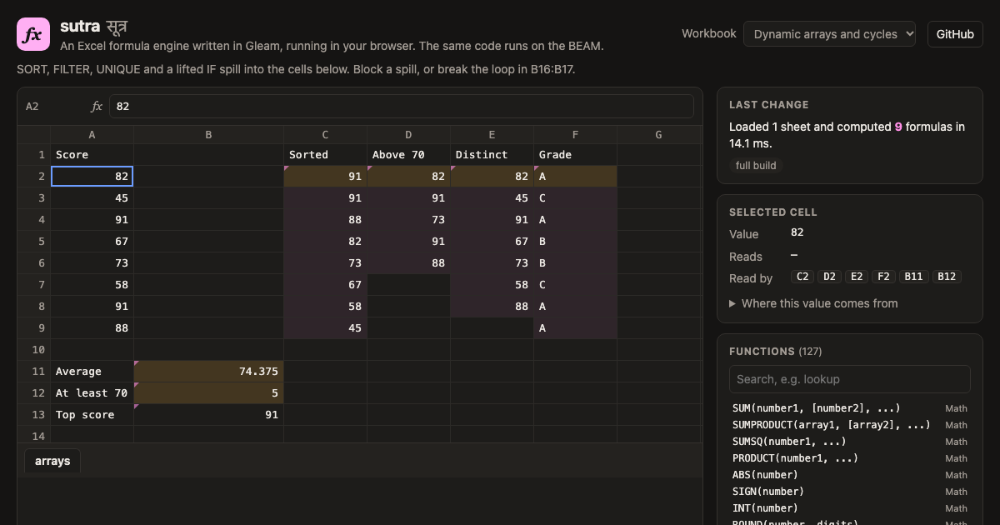

# sutra

[](https://github.com/SAMARTHJAISWAL/sutra/actions/workflows/ci.yml)
[](https://sutra-amber.vercel.app/)
[](https://gleam.run)
[](LICENSE)

**An Excel formula engine written in Gleam.** It parses formulas, keeps the
dependency graph between cells, recalculates only what an edit affects,
spills dynamic arrays and reports circular references, using 127 Excel
functions. One codebase runs on the BEAM (Erlang, Elixir, Gleam services)
and in JavaScript (browsers, Node).

*Sutra* (सूत्र) is the Hindi word for a formula.

**[Try it in your browser →](https://sutra-amber.vercel.app/)**
The demo is the Gleam engine compiled to JavaScript, with no server.
It is also mirrored on [GitHub Pages](https://samarthjaiswal.github.io/sutra/).

[](https://sutra-amber.vercel.app/)

## Why

A lot of business logic lives in spreadsheets: pricing rules, commission
plans, loan schedules, KPI definitions. Moving that logic into an
application usually means rewriting it by hand and hoping nothing drifts.
With sutra the formulas stay formulas, and you can:

- evaluate a sheet of formulas inside a backend service;
- check a workbook for broken formulas in CI;
- show where a number comes from, cell by cell;
- give users a live, Excel-compatible calculator in the browser.

## Quick start

You need [Gleam](https://gleam.run/getting-started/installing/) and Erlang (or Node for the JavaScript target).

```sh
git clone https://github.com/SAMARTHJAISWAL/sutra
cd sutra
gleam run -- eval fixtures/loan.csv
```

Each CSV file is one sheet, named after the file, and cells starting with `=` are formulas.

```
$ sutra eval fixtures/loan.csv
   A                B
1  Loan model
2  Principal             250000
3  Annual rate            0.075
4  Years                     20
5  Monthly payment  2013.982984
6  Total paid       483355.9161
7  Total interest   233355.9161
8  Interest share         48.3%
```

Several files make a workbook whose sheets can refer to each other.
[`summary.csv`](fixtures/summary.csv) spills a sorted list of regions with
`=SORT(UNIQUE(sales!B2:B13))`, then fills each row with `SUMIFS`, `XLOOKUP`
and `MAXIFS` over the other two sheets:

```
$ sutra eval fixtures/sales.csv fixtures/targets.csv fixtures/summary.csv
...
summary
   A       B        C      D       E           F
1  Region  Revenue  Units  Target  Attainment  Best rep
2  East      14725    280   14000        105%  Meera
3  North     16325    285   15000        109%  Asha
4  South     15375    315   16000         96%  Ravi
5  West      16550    245   20000         83%  Kabir
6  Total     62975   1125   65000         97%
```

`check` lists every formula that ends in an error, with the reason, and
exits 1 so it can gate a CI job. An error that only passes another cell's
error along is traced back to it:

```
$ sutra check fixtures/broken.csv
broken!B2  #DIV/0!  =10/B5
    division by zero
broken!B3  #N/A  =VLOOKUP("Zed",A2:A3,1,FALSE)
    value not available (a lookup found no match)
broken!B4  #CYCLE!  =B4+1
    circular reference: this cell depends on itself
broken!B6  #NAME?  =SUMM(B2:B3)
    unknown function or name
broken!B7  #ERROR!  =SUM(B2
    cannot parse: missing ) after arguments (at character 8)
broken!B8  #SPILL!  =SEQUENCE(3)
    the array result has no room to spill: cells below or to the right are not empty
broken!B10  #DIV/0!  =B2*2
    comes from broken!B2

7 formula errors
```

`explain` traces where a value comes from, through formulas, ranges, other
sheets and spilled arrays:

```
$ sutra explain fixtures/sales.csv fixtures/targets.csv fixtures/summary.csv summary!D3
summary!D3 = 15000   =XLOOKUP(A3,targets!A2:A5,targets!B2:B5,0)
  summary!A3 = "North"   (spilled from summary!A2)
    summary!A2 = "East"   =SORT(UNIQUE(sales!B2:B13))
      sales!B2:B13   12 cells, 0 numbers
  targets!A2:A5   4 cells, 0 numbers
  targets!B2:B5   4 cells, 4 numbers, sum 65000
```

`calc` evaluates one formula:

```
$ sutra calc '=TEXT(EOMONTH(DATE(2024,1,15),1),"dddd, d mmmm yyyy")'
Thursday, 29 February 2024

$ sutra calc '=SORT(UNIQUE({"chai";"coffee";"chai";"cocoa"}))'
   A
1  chai
2  cocoa
3  coffee
```

The other options are `eval --format csv|json` and `sutra functions`.

To get a standalone command, run `gleam export erlang-shipment`, then use `build/erlang-shipment/entrypoint.sh run <command> ...`.

## As a library

```gleam
import sutra
import sutra/value
import sutra/workbook

pub fn main() {
  // one formula on its own
  let assert Ok([[payment]]) = sutra.evaluate("=ROUND(PMT(7.5%/12, 240, 250000), 2)")
  // payment == value.Number(-2013.98)

  // cells that refer to each other: #(sheet, column, row, input), zero-based
  let #(book, _) =
    workbook.from_cells(["Sheet1"], [
      #("Sheet1", 0, 0, "120"),
      #("Sheet1", 0, 1, "80"),
      #("Sheet1", 1, 0, "=SUM(A1:A2)*1.18"),
    ])
  workbook.value(book, "Sheet1", 1, 0) |> value.to_string  // "236"

  // an edit recalculates only the formulas that can see it
  let assert Ok(#(book, report)) = workbook.set_a1(book, "Sheet1", "A2", "100")
  workbook.value(book, "Sheet1", 1, 0) |> value.to_string  // "259.6"
  report.evaluated  // [Key("sheet1", 1, 0)]: only B1 ran again
}
```

These examples are in [`test/readme_test.gleam`](test/readme_test.gleam),
so they are checked on every CI run.

Gleam compiles to ordinary BEAM modules, so Erlang and Elixir code can call
the engine directly:

```erlang
1> sutra:evaluate(<<"=XLOOKUP(\"b\", {\"a\";\"b\"}, {10;20})">>).
{ok,[[{number,20.0}]]}
2> {Book, _} = 'sutra@workbook':from_cells([<<"Sheet1">>], [{<<"Sheet1">>, 0, 0, <<"=SEQUENCE(3)*2">>}]).
3> 'sutra@workbook':value(Book, <<"Sheet1">>, 0, 2).
{number,6.0}
```

## What it supports

| Category | Count | Functions |
|---|---|---|
| Math | 24 | `SUM`, `SUMPRODUCT`, `SUMSQ`, `PRODUCT`, `ABS`, `SIGN`, `INT`, `ROUND`, `ROUNDUP`, `ROUNDDOWN`, `TRUNC`, `MROUND`, `CEILING`, `FLOOR`, `MOD`, `QUOTIENT`, `POWER`, `SQRT`, `EXP`, `LN`, `LOG`, `LOG10`, `PI`, `FACT` |
| Logic | 13 | `IF`, `IFS`, `IFERROR`, `IFNA`, `SWITCH`, `CHOOSE`, `LET`, `AND`, `OR`, `XOR`, `NOT`, `TRUE`, `FALSE` |
| Lookup | 8 | `VLOOKUP`, `HLOOKUP`, `XLOOKUP`, `MATCH`, `XMATCH`, `INDEX`, `ROWS`, `COLUMNS` |
| Conditional | 8 | `SUMIF`, `SUMIFS`, `COUNTIF`, `COUNTIFS`, `AVERAGEIF`, `AVERAGEIFS`, `MAXIFS`, `MINIFS` |
| Statistics | 19 | `AVERAGE`, `AVERAGEA`, `COUNT`, `COUNTA`, `COUNTBLANK`, `MIN`, `MAX`, `MEDIAN`, `MODE.SNGL`, `STDEV.S`, `STDEV.P`, `VAR.S`, `VAR.P`, `LARGE`, `SMALL`, `RANK.EQ`, `PERCENTILE.INC`, `QUARTILE.INC`, `CORREL` |
| Text | 23 | `LEN`, `LEFT`, `RIGHT`, `MID`, `UPPER`, `LOWER`, `PROPER`, `TRIM`, `CLEAN`, `CONCAT`, `CONCATENATE`, `TEXTJOIN`, `SUBSTITUTE`, `REPLACE`, `FIND`, `SEARCH`, `REPT`, `EXACT`, `VALUE`, `TEXT`, `FIXED`, `CHAR`, `CODE` |
| Date | 10 | `DATE`, `DATEVALUE`, `YEAR`, `MONTH`, `DAY`, `WEEKDAY`, `EDATE`, `EOMONTH`, `DAYS`, `DATEDIF` |
| Finance | 6 | `PMT`, `PV`, `FV`, `NPER`, `NPV`, `IRR` |
| Information | 11 | `ISNUMBER`, `ISTEXT`, `ISNONTEXT`, `ISLOGICAL`, `ISBLANK`, `ISERROR`, `ISERR`, `ISNA`, `ISEVEN`, `ISODD`, `NA` |
| Dynamic arrays | 5 | `SEQUENCE`, `SORT`, `UNIQUE`, `FILTER`, `TRANSPOSE` |

The older names `STDEV`, `STDEVP`, `VAR`, `VARP`, `MODE`, `RANK`,
`PERCENTILE`, `QUARTILE`, `CEILING.MATH` and `FLOOR.MATH` work too, as does
the `_xlfn.` prefix that saved files put on newer functions.

The language covers:

- **Operators.** Arithmetic, `&`, the six comparisons and postfix `%`. Precedence follows Excel rather than mathematics: `=-2^2` is 4, and `^` is left-associative, so `=2^3^2` is 64.
- **References.**
  - Cells and ranges: `A1`, `$B$2`, `A1:C9`.
  - Whole columns and rows: `C:C`, `2:5`.
  - Other sheets, including quoted names: `Sales!B2`, `'Q3 Plan'!A1:A9`.
- **Other syntax.** Array constants such as `{1,2;3,4}`, `LET` variables, and omitted arguments such as `IF(A1,,0)`.
- **Excel's error values.** `#DIV/0!`, `#N/A`, `#NAME?`, `#NUM!`, `#REF!`, `#VALUE!`, `#SPILL!` and `#CALC!`. Two more cover what Excel reports in dialogs: `#CYCLE!` for a circular reference and `#ERROR!` for a formula that does not parse.
- **Arrays everywhere.**
  - Operators and scalar functions work element-wise, so `=LEN(A1:A3)` and `=IF(A1:A9>70,"pass","fail")` return arrays.
  - A formula that returns an array spills into the cells below and to the right.
- **Excel's number rules.**
  - Up to 15 significant digits are shown.
  - Comparisons forgive binary noise, so `=0.1+0.2=0.3` is TRUE.
  - `ROUND` works on the decimal you see: `ROUND(1.005,2)` is 1.01, not the 1.0 that float arithmetic gives.
  - Dates use the 1900 date system, including its deliberate 1900 leap-year bug, so serial numbers match real spreadsheets.

## How it works

```
input ──► lexer ──► Pratt parser ──► AST ──► evaluator ──► value or array
                                       │
                                       ▼
                            workbook: dependency graph
                   (reverse index from each cell to its readers)
                                       │
           edit ──► downstream closure ──► topological order ──► evaluate ──► spill
```

- **Reverse index.** Each formula's references are indexed from cell to
  reader. Small ranges are expanded cell by cell. Large and whole-column
  ranges are kept as areas and checked on demand, so `=SUM(A:A)` costs
  nothing up front.
- **Incremental recalculation.** An edit collects everything downstream of
  the changed cell, orders it with Kahn's algorithm, and evaluates each
  formula once, after all of its inputs. Formulas the edit cannot reach
  are not touched. In the demo's sales workbook, changing one sale's units
  re-runs 20 of the 37 formulas.
- **Circular references.** A formula is a circular reference only if its
  *references* form a loop. Those cells get `#CYCLE!`, while the formulas
  downstream of the loop still compute and inherit the error, as in Excel.
- **Spilling dynamic arrays.**
  - Reading a spilled cell means waiting for the array that spills there.
  - An array is blocked with `#SPILL!` when its area holds a value, or
    when another array already spills there.
  - When two arrays want the same cells, an array never evicts one whose
    output it reads; otherwise the formula that comes first wins.
  - An array that reads its own spilled output is a circular reference.
  - All of these rules are applied the same way however the workbook got
    into its state.
- **When the engine rebuilds.** An array changing shape, or arrays
  competing for cells, can affect formulas nobody could have known about
  in advance. In those cases the engine recomputes the workbook from its
  inputs. Edits that do not involve that, which is nearly all of them, stay
  incremental, and the recalculation report says which kind happened.
- **The same numbers on every target.** On the BEAM a float overflow
  raises an exception; in JavaScript it quietly becomes `Infinity`. Every
  operation is checked first and returns `#NUM!` like Excel, and numbers
  are formatted from their shortest decimal form rather than by the host's
  `toString`. As a result, the Erlang and JavaScript targets print
  identical output.

## Testing

```sh
gleam test                       # on the BEAM
gleam test --target javascript   # on Node
```

- **Formula results.** 234 formulas are checked against Excel's
  answers, including every finance example from Microsoft's documentation
  (`PMT`, `PV`, `FV`, `NPER`, `NPV`, `IRR`).
- **Engine behaviour.** Separate tests cover the parser (precedence,
  references, error positions, printing and re-parsing), the workbook
  (dependency order, cycles, spills, blocking, multi-sheet), number
  formatting, dates, CSV and the CLI.
- **Differential fuzzing** of incremental recalculation
  ([`test/fuzz_test.gleam`](test/fuzz_test.gleam)).
  - Random workbooks get random edits: numbers, text, clears, references,
    ranges, cross-sheet formulas, circular references, and spilling arrays
    that collide and block each other.
  - After every edit, the incrementally updated workbook must hold exactly
    the values of a workbook built from scratch from the same inputs.
  - CI runs 300 scenarios of 25 edits on each target. Before release it ran
    20,000 scenarios on Erlang and 5,000 on JavaScript (625,000 edits)
    without a mismatch.
  - The fuzzer is what shaped the spill rules above: each rule fixed a case
    where the result depended on the order of earlier edits.
- **Readme examples.** The library examples in this README are tests too.

## Differences from Excel

sutra aims to compute what Excel computes, not to be Excel:

- **No volatile or reference-building functions.** `TODAY`, `NOW`,
  `RAND`, `OFFSET` and `INDIRECT` are missing; results depend only on
  the inputs.
- **No per-cell number formats.** Cells hold values. `TEXT` formats on
  request and supports the common codes: `0.00`, `#,##0`, `0%`,
  `$#,##0;(#,##0)`, `0.00E+00` and date codes.
- **Whole columns are clipped.** Whole-column and whole-row ranges stop at
  the last used cell, so `ROWS(A:A)` counts used rows rather than 1,048,576.
- **Not supported:** named ranges, structured table references, the `@`
  operator, `A1#` spill references, and wildcards in `SEARCH`.
- **Text length.** `LEN` counts characters as people see them, while Excel
  counts UTF-16 units, so emoji and some scripts differ.
- **Input and output.** It reads and writes CSV, not `.xlsx` files.

## Alternatives

There are mature formula engines in other languages. sutra is not a
replacement for them; it fills a different niche.

- **[HyperFormula](https://hyperformula.handsontable.com/)** (TypeScript) is a
  full headless spreadsheet engine with several hundred functions, available
  under GPLv3 or a commercial licence.
- **[Formula.js](https://formulajs.info/)** (JavaScript) implements Excel
  functions without a dependency graph or recalculation.
- **[IronCalc](https://www.ironcalc.com/)** (Rust) is a spreadsheet engine
  that also runs in the browser through WebAssembly.
- **Python's `formulas` and `pycel`** compute existing `.xlsx` workbooks.

What sutra offers instead:

- **For the BEAM.** It is a native engine for the BEAM, so Erlang, Elixir
  and Gleam services can evaluate spreadsheets in-process. I am not aware
  of another formula engine written in Gleam.
- **Two targets, one codebase.** The same code runs in the browser and the
  two targets agree to the last digit.
- **Small and MIT-licensed.**
- **Tested against its own simpler model.** Incremental recalculation is
  fuzzed against a full rebuild.

## Project layout

```
src/sutra.gleam            CLI entry point and sutra.evaluate
src/sutra/parser.gleam     lexer and Pratt parser
src/sutra/ast.gleam        syntax tree, A1 addresses, printing
src/sutra/eval.gleam       operators, references, array broadcasting
src/sutra/functions.gleam  the 127 functions
src/sutra/workbook.gleam   dependency graph, recalculation, spills, cycles
src/sutra/value.gleam      values, errors, coercion, number formatting
src/sutra/num.gleam        overflow-safe arithmetic, decimal rounding
src/sutra/format.gleam     TEXT format codes
src/sutra/criteria.gleam   SUMIF-style criteria and wildcards
src/sutra/dates.gleam      1900 date serials
src/sutra/cli.gleam        eval, check, explain, calc
src/sutra/web.gleam        JSON API used by the demo
web/                       the demo page (plain ES modules, no bundler)
fixtures/                  example workbooks
```

To build the demo locally, run `./web/build.sh`, then serve `_site/`
with any static file server.

## License

[MIT](LICENSE)
